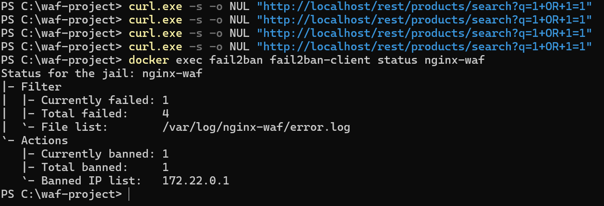
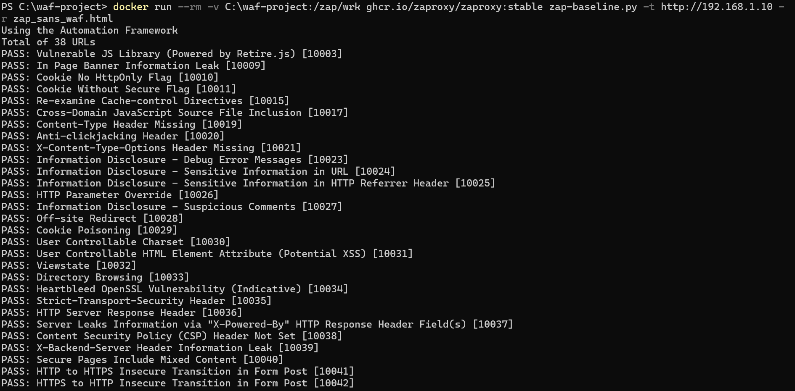

# Reverse Proxy WAF (Nginx + ModSecurity + OWASP CRS) devant Juice Shop

Ce projet, c'est la mise en place d'un WAF (Web Application Firewall) devant une application volontairement vulnérable, **OWASP Juice Shop**, pour voir concrètement ce qu'un WAF bloque, ce qu'il ne bloque pas, et où sont ses limites. Tout tourne en conteneurs Docker : un reverse proxy Nginx couplé à ModSecurity et aux règles OWASP CRS filtre le trafic avant qu'il n'atteigne l'application.

L'idée n'était pas juste de "faire marcher" un WAF, mais de le tester sérieusement : attaques OWASP Top 10, réglage du niveau de sensibilité, faux positifs, contournements possibles, et validation externe avec Nmap et OWASP ZAP.

## Ce que ça fait

- Un reverse proxy Nginx avec WAF intégré (ModSecurity + OWASP CRS) devant Juice Shop
- Blocage testé sur les attaques classiques : injection SQL, XSS, LFI, XSS encodé
- Comparaison des 4 niveaux de paranoïa du WAF (PARANOIA=1 à 4), avec leurs faux positifs
- Des en-têtes de sécurité HTTP (HSTS, CSP, Referrer-Policy)
- Un rate limiting sur la page de login pour couper court au brute force
- HTTPS avec un certificat auto-signé
- Fail2ban qui bannit automatiquement une IP après plusieurs 403 rapprochés
- Des scans Nmap et OWASP ZAP pour vérifier, de l'extérieur, que ça tient vraiment la route

## Architecture

```
Client (navigateur / curl / Nmap / ZAP)
        │
        ▼
Nginx + ModSecurity (OWASP CRS)   ← reverse proxy + WAF, port 80/443
        │
        ▼
Juice Shop                        ← l'application cible, port 3000 en interne
```

Les deux conteneurs (`nginx-waf` et `juiceshop`) sont sur le même réseau Docker. Nginx ne fait que rediriger le trafic vers Juice Shop une fois qu'il est passé par le filtre ModSecurity — pas une ligne de config Nginx écrite à la main, tout passe par les variables d'environnement de l'image `owasp/modsecurity-crs`.

## Stack utilisée

Docker / Docker Compose, Nginx + ModSecurity (OWASP CRS), OWASP Juice Shop, Fail2ban, Nmap, OWASP ZAP, PowerShell/curl pour les tests.

## Comment le lancer

```bash
git clone https://github.com/FatouGueye123/waf-project.git
cd waf-project
docker compose up -d
docker ps          # les deux conteneurs doivent être "Up"
```

Puis direction `http://localhost` : la page d'accueil de Juice Shop doit s'afficher.

Si erreur 502 → Juice Shop n'a pas fini de démarrer, attends 10-15 secondes et recharge. Si rien ne charge du tout → vérifie que le port 80 n'est pas déjà pris par autre chose sur ta machine.

## Est-ce que ça bloque vraiment les attaques ?

Testé directement en curl sur le proxy, avec PARANOIA=2 :

| Attaque | Payload | Résultat |
|---|---|---|
| Injection SQL | `?q=1 OR 1=1` | Bloqué (403) |
| XSS | `?q=<script>alert(1)</script>` | Bloqué (403) |
| LFI | `?file=../../../etc/passwd` | Bloqué (403) |
| XSS encodé | `?q=%3Cscript%3E...` | Bloqué (403) — le WAF décode l'URL avant d'analyser |
| Recherche normale | `?q=apple` | Passe (200) — pas de faux positif |

Donc : 100% des attaques testées bloquées, et le trafic légitime continue de passer normalement. C'est le résultat qu'on veut voir.


Et pour prouver que c'est vraiment le WAF qui bloque tout ça (pas autre chose), je l'ai désactivé temporairement et rejoué les mêmes tests : les quatre attaques passent alors en 200 OK, sans aucune résistance.


## Et le niveau de paranoïa, ça change quoi ?

Le WAF a 4 niveaux de sensibilité, et plus on monte, plus il détecte de choses — mais plus il se trompe aussi :

| Niveau | Ce qu'il détecte en plus | Faux positifs |
|---|---|---|
| PARANOIA=1 | Attaques évidentes | Très rares |
| PARANOIA=2 | Encodages avancés | Rares — **c'est le niveau gardé pour ce projet** |
| PARANOIA=3 | Détection comportementale | Ça commence à se voir |
| PARANOIA=4 | Le maximum | Beaucoup trop pour un usage normal |

À PARANOIA=4, une simple apostrophe dans "l'orange" fait planter la requête (500), et une requête POST JSON parfaitement valide peut être coupée. C'est un bon exemple concret de pourquoi il ne faut pas mettre le niveau au max juste parce qu'on peut : PARANOIA=2 reste le meilleur compromis entre sécurité et utilisabilité.


## Le reste de la protection

- En-têtes de sécurité (HSTS, CSP, Referrer-Policy) ajoutés et vérifiés
- Rate limiting sur `/rest/user/login` : 5 requêtes/minute, au-delà ça répond 429
- HTTPS activé avec un certificat auto-signé
- Fail2ban qui surveille les logs et bannit une IP 5 minutes après 3 réponses 403 en moins d'une minute



## Et les tentatives de contournement ?

J'ai aussi testé deux techniques de fragmentation (répartir le payload sur plusieurs paramètres, ou couper une balise en deux). Dans les deux cas, le WAF a quand même bloqué la requête grâce au score cumulé des règles CRS.

Ceci dit, il faut rester honnête là-dessus : ça ne veut pas dire que toute fragmentation est détectée. Avec 3 paramètres ou plus, il est probable qu'on puisse passer sous le radar. C'est une limite réelle du WAF, pas juste une case à cocher.

## Validation depuis l'extérieur (Nmap + ZAP)

- Nmap ne voit que les ports 80/443 ouverts, et la version de Nginx n'est pas visible
- Avec OWASP ZAP, j'ai comparé un scan WAF actif vs WAF désactivé : ZAP explore **38 URLs sans WAF contre seulement 3 avec le WAF actif**, soit environ **92% de réduction de la surface d'attaque exposée**



Le WAF a été coupé temporairement pour faire cette comparaison, puis réactivé tout de suite après, avec une vérification par curl pour confirmer que le blocage était bien de retour.

## Ce que ce projet ne couvre pas

Un WAF bloque des signatures d'attaques connues, pas les failles logiques métier ni les attaques zero-day. Le niveau PARANOIA choisi est un compromis, pas une garantie. Et la protection contre la fragmentation a ses limites, comme expliqué plus haut.

## Structure du dépôt

```
waf-project/
├── README.md
├── docker-compose.yml
├── fail2ban/
│   ├── filter.d/nginx-waf.conf
│   └── jail.d/nginx-waf.conf
├── docs/
│   ├── rapport-complet.pdf
│   └── screenshots/        # 36 captures, numérotées dans l'ordre chronologique
└── .gitignore
```

> Sur Windows, ce dossier correspond à `C:\waf-project`.

## En une phrase pour le CV

Sécurisation d'une application web par WAF (Nginx + ModSecurity + OWASP CRS) — architecture Docker, tests OWASP Top 10 (100% de détection), réduction de 92% de la surface d'attaque mesurée via OWASP ZAP, défense en profondeur (Fail2ban, rate limiting, HTTPS).
